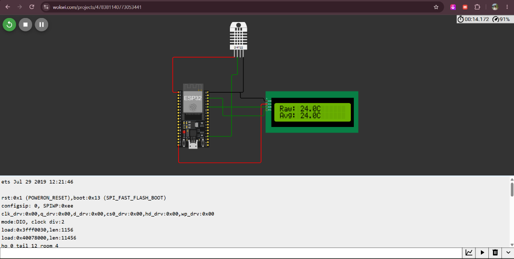
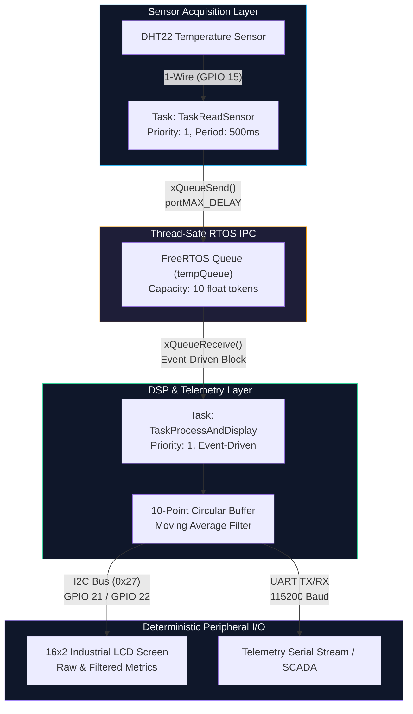

# FreeRTOS Industrial Telemetry & Fault Monitoring Node

[](https://github.com/kunaljit3006/ESP32-FreeRTOS-Sensor-Hub)
[-003B57?style=for-the-badge&logo=espressif&logoColor=white)](https://www.espressif.com/)
[](https://www.freertos.org/)
[](https://isocpp.org/)
[](https://wokwi.com)
[](LICENSE)

An industry-grade, deterministic edge telemetry and fault monitoring node engineered on the **ESP32** dual-core microcontroller using **C++** and **FreeRTOS**. 

The system simulates mission-critical data acquisition (DAQ) architectures commonly deployed in industrial field operations (e.g., oilfield wellhead telemetry, rotating equipment thermal monitoring, and SCADA sensor nodes). It features preemptive multi-tasking, thread-safe Inter-Task Communication (IPC) via FreeRTOS Queues, low-overhead digital signal filtering (circular buffer moving average), and multi-peripheral telemetry dispatch (I2C LCD and UART).

---

## Simulation Preview

[](https://wokwi.com/projects/478381140773053441)



---

## Table of Contents

- [Project Overview](#project-overview)
- [System Architecture & RTOS Design](#system-architecture--rtos-design)
- [Digital Signal Processing (DSP) & Statistical Analysis](#digital-signal-processing-dsp--statistical-analysis)
- [Hardware & Pinout Mapping](#hardware--pinout-mapping)
- [Repository Structure](#repository-structure)
- [Firmware Implementation](#firmware-implementation)
- [Telemetry & Serial Diagnostics](#telemetry--serial-diagnostics)
- [How to Run the Simulation](#how-to-run-the-simulation)
- [License](#license)

---

## Project Overview

In harsh industrial environments, sensor data lines are continuously exposed to electromagnetic interference (EMI), switching transients from variable-frequency drives (VFDs), and thermal noise. Traditional monolithic `loop()`-based microcontrollers encounter latency jitter, blocking I/O penalties, and susceptibility to sensor race conditions.

This telemetry node resolves these challenges by decoupling **data acquisition** from **signal processing & telemetry output**:
- **Deterministic Sampling**: High-precision periodic polling ($T_s = 500\text{ ms}$) without jitter or software drift.
- **Deterministic Inter-Task Decoupling**: FreeRTOS FIFO Queues isolate time-sensitive sensor acquisition from relatively slow peripheral buses (I2C and UART).
- **Transient Spike Rejection**: Real-time 10-point moving average filtering attenuates high-frequency noise and ADC/digital glitches prior to local visualization and SCADA broadcast.
- **Non-blocking Execution**: Complete elimination of blocking delay functions (`delay()`), allowing the RTOS scheduler to transition tasks into `BLOCKED` states to maximize processor efficiency.

---

## System Architecture & RTOS Design

The firmware runs on the **FreeRTOS Preemptive Kernel**, coordinating two concurrent tasks communicating via a thread-safe Queue handle (`tempQueue`).



### FreeRTOS Tasks & IPC Specification

| Task Identifier | Function Name | Priority | Stack Depth | Scheduling Behavior | Responsibility |
|---|---|---|---|---|---|
| `ReadSensor` | `TaskReadSensor` | `1` | `2048 words` | Periodic (500 ms) | Samples DHT22 via digital protocol, checks `!isnan()` validity, and pushes valid frames to `tempQueue` via `xQueueSend()`. |
| `ProcessDisplay` | `TaskProcessAndDisplay` | `1` | `2048 words` | Event-Driven (`portMAX_DELAY`) | Suspends until data arrives in `tempQueue`. Executes DSP moving average filter, formats telemetry, and pushes to LCD and UART. |

### Concurrency & Race Condition Prevention
- **Producer-Consumer Pattern**: `TaskReadSensor` acts as the producer; `TaskProcessAndDisplay` acts as the consumer.
- **Mutex-Free Zero-Contention**: Rather than sharing raw memory buffers guarded by mutexes (which risk priority inversion and locking overhead), state transfer is executed via a copy-by-value FreeRTOS FIFO queue (`xQueueCreate(10, sizeof(float))`).
- **Zero-Busy-Wait Sleep**: Timing intervals are strictly governed by `vTaskDelay(pdMS_TO_TICKS(500))`, placing the task in the FreeRTOS `BLOCKED` list and yielding CPU execution slots to idle tasks or lower-priority operations.

---

## Digital Signal Processing (DSP) & Statistical Analysis

The node implements an in-memory **10-Point Circular Buffer Moving Average Filter** to suppress high-frequency signal noise, ADC quantification noise, and environmental temperature spikes.

### Mathematical Formulation
The filter output $y[n]$ is computed across an $N$-point window ($N = 10$):

$$y[n] = \frac{1}{N} \sum_{k=0}^{N-1} x[n-k]$$

### $O(1)$ Computational Efficiency
Rather than re-summing all elements upon each new sample ($O(N)$ overhead), the algorithm executes in strict **$O(1)$ constant time and space**:

$$S_n = S_{n-1} - x[n - N] + x[n]$$

$$\bar{x}_n = \frac{S_n}{\min(n, N)}$$

```cpp
// O(1) Sliding Window Moving Average Filter
sum = sum - readings[index];      // Evict oldest sample
readings[index] = temp;           // Insert incoming sensor sample
sum = sum + temp;                 // Accumulate new value
index = (index + 1) % 10;         // Advance circular head pointer
if (count < 10) count++;          // Transient startup ramp-up counter
float avgTemp = sum / count;      // Compute instantaneous filtered average
```

**Benefits**:
1. Zero dynamic memory allocation (`malloc`), guaranteeing deterministic execution without heap fragmentation.
2. Graceful ramp-up handling for initial samples ($count < 10$) without zero-initialization bias.

---

## Hardware & Pinout Mapping

| Component | Subsystem | Module Pin | ESP32 GPIO | Electrical Specs | Description |
|---|---|---|---|---|---|
| **ESP32 DevKit v1** | MCU Host | - | - | 3.3V Logic | Dual Xtensa 32-bit LX6 Microcontroller |
| **DHT22 (AM2302)** | Thermal Sensor | `VCC` | `3V3` | 3.3V DC | Main sensor power rail |
| | | `GND` | `GND` | 0V Reference | Ground rail |
| | | `SDA` / `DATA` | `GPIO 15` | Digital I/O | 1-Wire proprietary serial communication |
| **16x2 LCD Display** | Operator HMI | `VCC` | `5V` / `VIN` | 5.0V DC | Liquid Crystal backlight & display power |
| | | `GND` | `GND` | 0V Reference | Ground rail |
| | | `SDA` | `GPIO 21` | 3.3V I2C (Internal Pull-Up) | I2C Serial Data line (Address: `0x27`) |
| | | `SCL` | `GPIO 22` | 3.3V I2C (Internal Pull-Up) | I2C Serial Clock line |
| **UART Serial Bus** | Industrial Telemetry | `TX0` / `RX0` | Default UART0 | 115200 Baud | Asynchronous serial telemetry log stream |

---

## Repository Structure

```text
ESP32-FreeRTOS-Sensor-Hub/
├── sketch.ino          # Core firmware (FreeRTOS tasks, DSP filter, hardware setup)
├── diagram.json        # Wokwi simulator circuit configuration & pin layout
├── libraries.txt       # Project dependencies (DHT sensor library, LiquidCrystal_I2C)
├── screenshot.png      # Hardware simulation & LCD diagnostic capture
└── README.md           # Engineering documentation and technical reference
```

---

## Firmware Implementation

The firmware is structured strictly within the RTOS paradigm. The Arduino `loop()` is intentionally left vacant, handing 100% of execution scheduling over to the FreeRTOS kernel:

```cpp
void setup() {
  Serial.begin(115200);
  dht.begin();
  lcd.init();
  lcd.backlight();

  // Thread-Safe Queue Creation (Depth: 10, Unit: sizeof(float))
  tempQueue = xQueueCreate(10, sizeof(float));

  // Task Instantiation with 2048-word Stack Allocations
  xTaskCreate(TaskReadSensor, "ReadSensor", 2048, NULL, 1, NULL);
  xTaskCreate(TaskProcessAndDisplay, "ProcessDisplay", 2048, NULL, 1, NULL);
}

void loop() {
  // Empty: Execution handled entirely by the FreeRTOS scheduler
}
```

---

## Telemetry & Serial Diagnostics

When deployed or running in simulation, the node continuously outputs real-time metrics over UART (115200 baud) and formats the visual operator interface on the 16x2 LCD.

### UART Telemetry Format
```text
Raw Temp: 24.80 C | Filtered Avg: 24.80
Raw Temp: 25.10 C | Filtered Avg: 24.95
Raw Temp: 25.40 C | Filtered Avg: 25.10
Raw Temp: 28.90 C | Filtered Avg: 25.86  <-- Noise Spike Attenuated
Raw Temp: 25.20 C | Filtered Avg: 25.75
```

### 16x2 I2C LCD Operator Interface
```text
+----------------+
|Raw: 25.2C      |
|Avg: 25.7C      |
+----------------+
```

---

## How to Run the Simulation

### Option A: Online Simulation via Wokwi
1. Open the project on [Wokwi Web Simulator](https://wokwi.com/projects/478381140773053441).
2. Click the **Play / Start Simulation** button.
3. Click the DHT22 sensor to modify temperature values interactively and observe the real-time response of the moving average filter on both the LCD screen and the Serial Monitor.

### Option B: Local Simulation (VS Code + Wokwi Extension)
1. Clone this repository:
   ```bash
   git clone https://github.com/kunaljit3006/ESP32-FreeRTOS-Sensor-Hub.git
   cd ESP32-FreeRTOS-Sensor-Hub
   ```
2. Install the **Wokwi Simulator** extension in Visual Studio Code.
3. Open the project folder in VS Code.
4. Press `F1` and select **Wokwi: Start Simulator**.

---

## Dependencies

The project relies on the following standard open-source embedded libraries (specified in `libraries.txt`):
- `DHT sensor library` by Adafruit (v1.4.4+)
- `Adafruit Unified Sensor` (v1.1.9+)
- `LiquidCrystal I2C` by Frank de Brabander (v1.1.2+)

---

## License

This project is licensed under the **MIT License** — see the [LICENSE](LICENSE) file for full details. Open-source and ready for commercial or educational prototyping.
